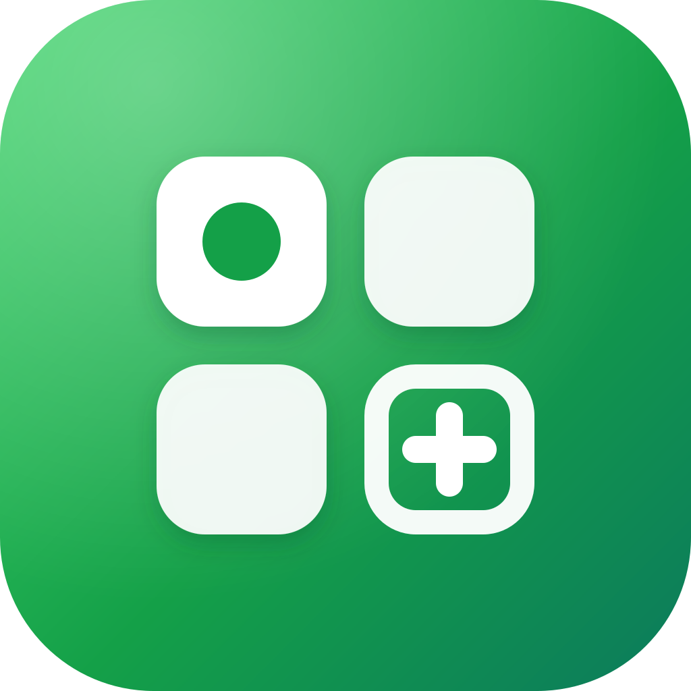
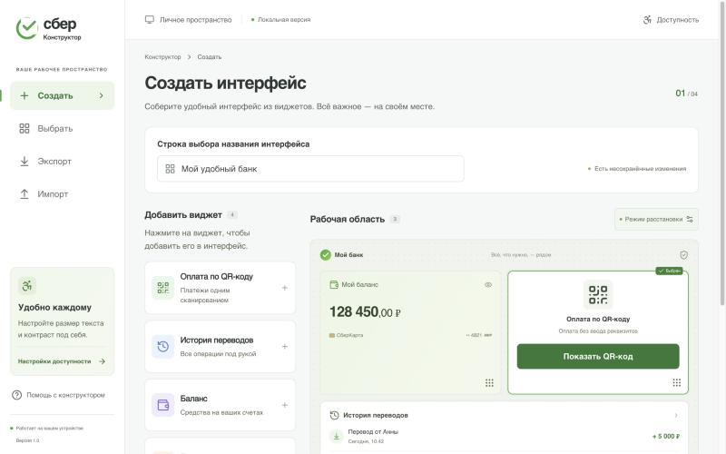
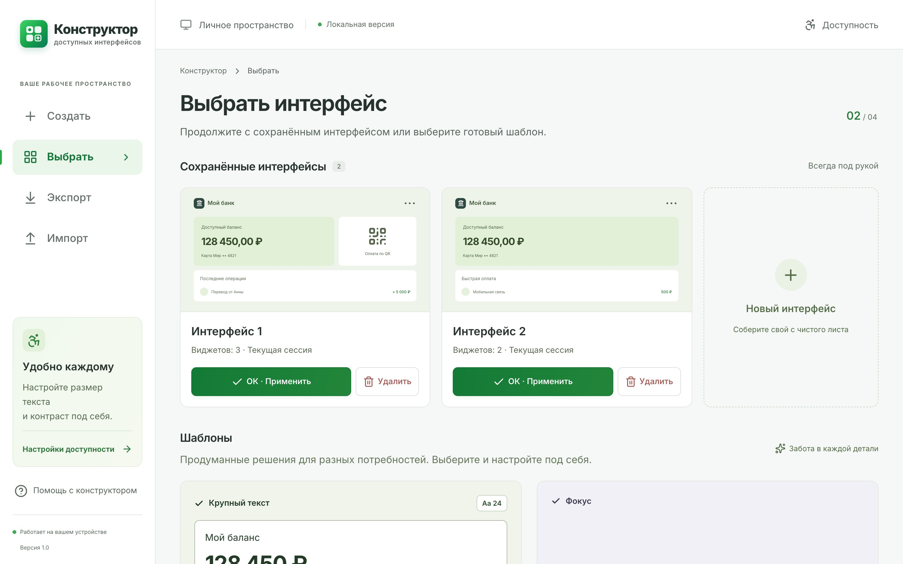
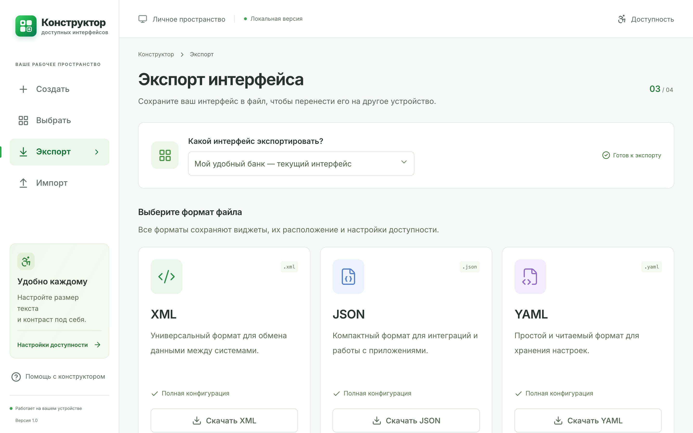
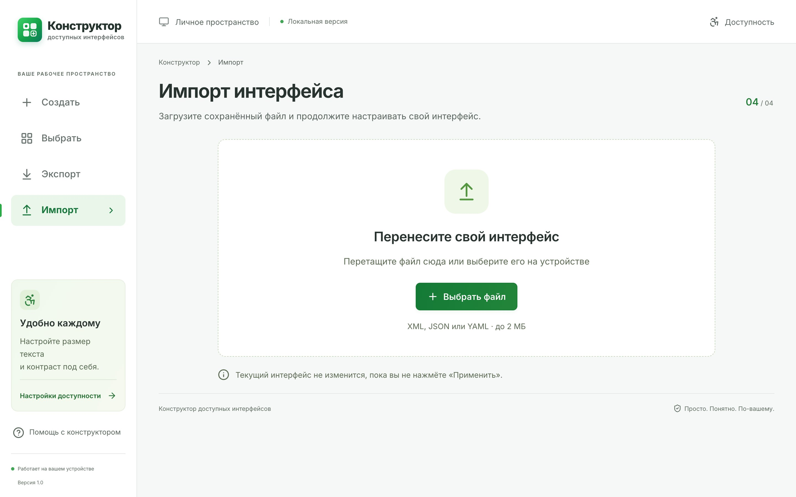

<div align="center">



# Конструктор доступных интерфейсов

**Коробочное решение, которое позволяет собрать понятный банковский интерфейс под свои потребности — для пожилых людей, людей с инвалидностью и всех, кому стандартное приложение неудобно.**

Стартап-проект · Заказчик — Сбер


[](https://github.com/TewCorejz/accessible-ui-constructor/actions/workflows/ci.yml)

**[▶ Открыть демо](https://tewcorejz.github.io/accessible-ui-constructor/)** · [Прототип в Figma Make](https://www.figma.com/make/FzdRdXWTrVs7QtX0a9d9p8/) · [Быстрый старт](#-быстрый-старт) · [Дорожная карта](#-дорожная-карта)



</div>

---

## 💡 Проблема и решение

Банковские приложения проектируются «для всех», а значит — ни для кого конкретно. Пожилому человеку мешает мелкий текст и десятки кнопок, человеку со слабым зрением — низкий контраст, человеку с когнитивными особенностями — перегруженные экраны.

**Конструктор** даёт пользователю (или его близким, или сотруднику отделения) собрать собственный главный экран из крупных понятных виджетов, выбрать подходящую тему доступности и перенести готовую настройку на любое устройство одним файлом.

## ✨ Возможности

| | |
|---|---|
| 🧩 **Сборка из виджетов** | Баланс, оплата по QR-коду, история переводов, быстрая оплата, студенческие виджеты. Перетаскивание (drag & drop) и изменение размера. |
| 🎨 **Готовые шаблоны** | «Крупный текст», «Фокус», «Высокий контраст», «Студент» — каждый под конкретный сценарий. |
| 💾 **Несколько интерфейсов** | Сохраняйте несколько вариантов и переключайтесь между ними. |
| 📤 **Экспорт / импорт** | Перенос настроек на другое устройство в форматах XML, JSON и YAML. Формат описан JSON Schema — [docs/config-format.md](docs/config-format.md). |
| ♿ **Доступность** | Крупные цели нажатия (от 64 px), основной текст 24 px, высокий контраст, режим без анимаций. |

### Шаблоны

| Шаблон | Для кого | Что внутри |
|---|---|---|
| **Крупный текст** | Пожилые люди | Баланс и быстрая оплата в одну колонку, текст 24 px, кнопки от 64 px |
| **Фокус** | Люди с когнитивными особенностями | Один виджет, одна основная кнопка, без анимаций |
| **Высокий контраст** | Люди со слабым зрением | Жёлто-чёрная палитра, крупный баланс и оплата по QR |
| **Студент** | Студенты | QR-коды пропуска и студенческого, подписки, мобильная связь |

## 🖼 Скриншоты

<table>
  <tr>
    <td></td>
    <td></td>
  </tr>
  <tr>
    <td align="center">Выбор интерфейса и шаблоны</td>
    <td align="center">Экспорт в XML / JSON / YAML</td>
  </tr>
  <tr>
    <td colspan="2"></td>
  </tr>
  <tr>
    <td colspan="2" align="center">Импорт сохранённой настройки</td>
  </tr>
</table>

## 🚀 Быстрый старт

**Без установки:** откройте [демо на GitHub Pages](https://tewcorejz.github.io/accessible-ui-constructor/) — оно обновляется автоматически после каждого слияния в `main`. Работает на компьютере и планшете.

**На телефоне** — отдельное мобильное приложение: [accessible-ui-constructor-mobile](https://github.com/TewCorejz/accessible-ui-constructor-mobile). Если открыть веб-версию на телефоне, она предложит установить приложение (веб-версию всё равно можно открыть). При увеличении страницы на компьютере конструктор перестраивается в одну колонку.

**Локально** — нужны **Node.js 22** и **pnpm 10+**.

```bash
git clone https://github.com/TewCorejz/accessible-ui-constructor.git
cd accessible-ui-constructor
pnpm install
pnpm dev
```

Приложение откроется на `http://localhost:8443` (порт можно поменять: `PORT=5173 pnpm dev`).

| Команда | Что делает |
|---|---|
| `pnpm dev` | Dev-сервер с горячей перезагрузкой |
| `pnpm build` | Production-сборка в `dist/` |
| `pnpm preview` | Локальный просмотр production-сборки |
| `pnpm typecheck` | Проверка типов TypeScript |
| `pnpm format` | Форматирование кода (oxfmt) |

## 🗂 Структура проекта

```
.
├── src/
│   ├── App.tsx               # Корневой компонент: навигация, страницы, каталог виджетов, шаблоны
│   ├── WidgetArrangement.tsx # Рабочая область с drag & drop (dnd-kit)
│   ├── StudentWidgets.tsx    # Виджеты шаблона «Студент» и быстрые действия
│   ├── TemplatePreview.tsx   # Мини-превью шаблонов
│   ├── index.css             # Глобальные стили, темы доступности, Tailwind v4
│   └── main.tsx              # Точка входа React
├── public/                   # Статика (favicon)
├── docs/                     # Документация и скриншоты
├── .figma/                   # Служебные файлы Figma Make (не удалять — нужны для синхронизации)
├── AGENTS.md, CLAUDE.md      # Инструкции для AI-агентов Figma Make
└── vite.config.ts            # Конфигурация Vite + плагины Figma Make
```

## 🛠 Технологии

- **React 19** + **TypeScript**
- **Vite 8** — сборка и dev-сервер
- **Tailwind CSS 4** — стили
- **dnd-kit** — перетаскивание виджетов
- **lucide-react** — иконки
- **yaml** — экспорт/импорт в YAML
- **Onest** ([@fontsource-variable/onest](https://fontsource.org/fonts/onest), лицензия OFL 1.1) — шрифт входит в сборку, без запросов к Google Fonts
- **Figma Make** — исходный прототип ([как синхронизировать](docs/figma-make.md))

## 🧭 Дорожная карта

- [x] Кликабельный прототип в Figma Make
- [x] Сборка интерфейса из виджетов, шаблоны доступности
- [x] Экспорт и импорт настроек (XML / JSON / YAML)
- [x] Сохранение интерфейсов между сессиями в браузере
- [ ] Сохранение на сервере (аккаунт пользователя)
- [x] Аудит доступности по WCAG 2.2 AA — [docs/accessibility-audit.md](docs/accessibility-audit.md)
- [ ] Ручная проверка со скринридерами NVDA и VoiceOver
- [x] Размер текста и палитра поверх любого шаблона (панель «Оформление и доступность»)
- [ ] Юзабилити-тестирование с целевыми группами — материалы готовы: [docs/research](docs/research)
- [x] Спецификация формата конфигурации для интеграции с банковским приложением — [docs/config-format.md](docs/config-format.md)
- [ ] Мобильное приложение — в отдельном репозитории [accessible-ui-constructor-mobile](https://github.com/TewCorejz/accessible-ui-constructor-mobile)

## 🤝 Участие в разработке

Как устроена работа с ветками, коммитами и pull request'ами — в [CONTRIBUTING.md](CONTRIBUTING.md).

## 📄 Лицензия и правовая информация

© 2026 Команда проекта «Конструктор доступных интерфейсов». Все права защищены — см. [LICENSE](LICENSE).

Проект разрабатывается командой стартапа по заказу Сбера и не является официальным продуктом ПАО Сбербанк. Товарные знаки «Сбер» и «СберБанк» принадлежат их правообладателю; в самом прототипе они не используются — у проекта собственное название и логотип. Все суммы, карты и операции в интерфейсе — вымышленные.
